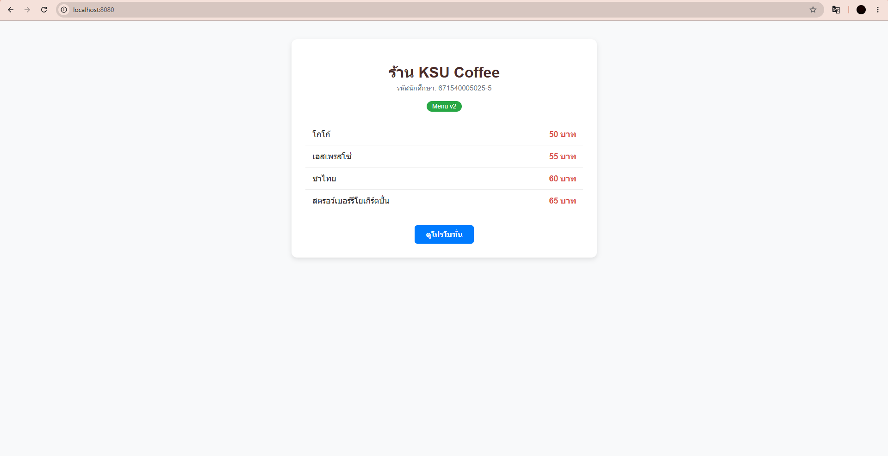
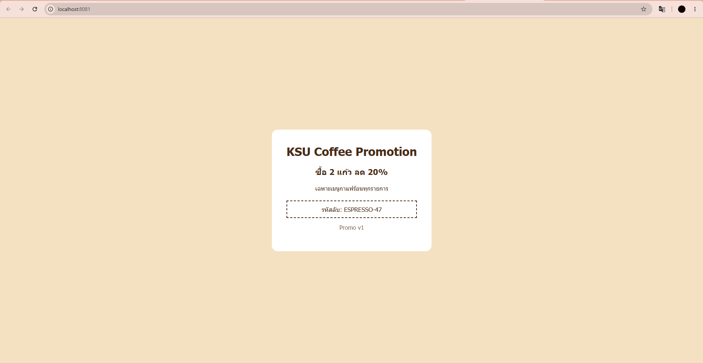

# ANSWER — พัฒน์นรี เรืองดิษฐ์ 671540005025-5

## Part A — ข้อมูลจาก image kamthornsa/ksu-promo:1.0

| คำถาม | คำตอบ | คำสั่งที่ใช้ |
| --- | --- | --- |
| Port | 3000/tcp | `docker inspect kamthornsa/ksu-promo:1.0` |
| CMD | ["node", "server.js"] | `docker inspect kamthornsa/ksu-promo:1.0` |
| Base image | node:alpine | `docker image history kamthornsa/ksu-promo:1.0` |

## Part B — รหัสลับบนหน้าโปรโมชั่น
ESPRESSO-47

## Part C — คำถาม

1. **ทำไมแก้ข้อความบนหน้าโปรโมชั่นไม่ได้ แต่หน้าเมนูแก้ได้**
หน้าโปรโมชั่นถูก Build เป็น Docker Image สำเร็จรูปมาแล้ว ไม่มีซอร์สโค้ดในเครื่องจึงแก้ไขภายในไม่ได้ ส่วนหน้าเมนูสร้างจากซอร์สโค้ด `index.html` ของเราเองจึงแก้ไขและ Build ใหม่ได้ตลอด

2. **ถ้าเขียน image: kamthornsa/ksu-promo โดยไม่ใส่ tag จะได้หน้าเว็บแบบไหน เพราะอะไร**
จะได้ Image ที่ระบุ Tag `:latest` โดยอัตโนมัติ ซึ่งอาจเป็นเวอร์ชันล่าสุดที่ผู้พัฒนาอัปเดตไว้ ทำให้เนื้อหาหรือรหัสลับอาจไม่ตรงกับเวอร์ชัน 1.0 ที่โจทย์กำหนด

3. **ใน ports: ของ service promo ตัวเลขฝั่งซ้ายและขวาของ : หมายถึงอะไร และทำไมฝั่งขวาไม่ใช่ 80**
ฝั่งซ้ายคือ Port บนเครื่องโฮสต์ (8081) และฝั่งขวาคือ Port ภายใน Container (3000) ที่แอปพลิเคชันรันอยู่ ที่ฝั่งขวาไม่ใช่ 80 เพราะตัวโปรแกรมด้านในถูกเขียนมาให้เปิดฟังคำขอที่พอร์ต 3000 ตามที่ Image กำหนด

4. **ถ้าแก้ index.html แล้วสั่งแค่ docker compose up -d จะเกิดอะไรขึ้น เพราะอะไร และคำสั่งที่ถูกต้องคืออะไร**
ระบบจะยังรัน Image เดิมที่เคย Build ไว้ทำให้หน้าเว็บไม่เปลี่ยน เพราะ Docker Compose จะไม่สร้าง Image ใหม่ให้อัตโนมัติ คำสั่งที่ถูกต้องคือ `docker compose up -d --build`

5. **ลิงก์ "ดูโปรโมชั่น" ใช้ URL อะไร และทำไมใช้ http://promo:3000 ไม่ได้ ทั้งที่ใน Compose เรียก service ด้วยชื่อได้**
ใช้ URL `http://localhost:8081` ใช้ `http://promo:3000` ไม่ได้เพราะลิงก์ทำงานบนเบราว์เซอร์ฝั่งผู้ใช้ (Client-side) ซึ่งอยู่ภายนอกเครือข่าย Docker จึงไม่รู้จักชื่อ Service ภายในเครือข่าย

## ภาพหน้าจอ

